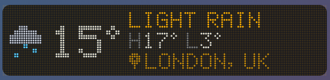
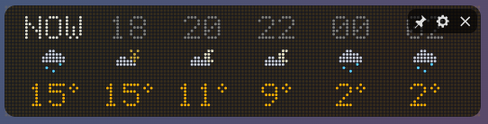
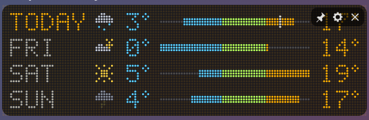
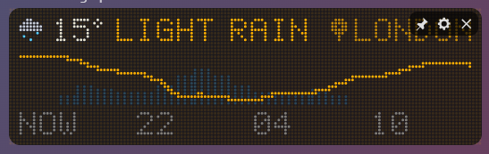
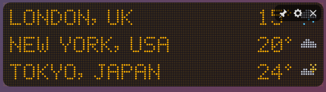
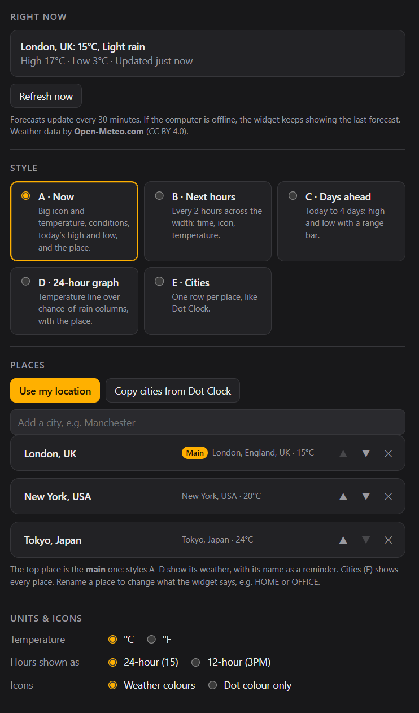

# Dot Weather

A dot-matrix weather widget for Windows and macOS, with animated icons: rain falls, snow drifts, the sun's rays pulse and thunder flashes.

## What it does

Pick one of five styles in settings:

| Style | What it shows |
|---|---|
| A · Now | A big icon and temperature, the conditions, today's high and low, and the place's name |
| B · Next hours | Every 2 hours across the width: time, icon, temperature |
| C · Days ahead | Today up to 4 days ahead (you choose how many), each with its high and low on a range bar. A white mark shows the temperature now |
| D · 24-hour graph | A temperature line over the chance of rain, with the place's name |
| E · Cities | One row per place, like Dot Clock, so the two stack neatly |

**Places:**
- Use your computer's location, search the built-in city list, or copy your cities from Dot Clock.
- Rename any place to change what the widget says, for example HOME or OFFICE.
- The top place is the main one, used by styles A–D. Cities (E) shows them all.

**More options:**
- **Units:** °C or °F, and 24- or 12-hour times.
- **Icons:** in weather colours, or all in the dot colour.
- **Matching Dot Clock:** same width, dot size and colours.

## Where the weather comes from

Forecasts come from [Open-Meteo](https://open-meteo.com/), which is free and needs no account or key. The widget updates every 30 minutes. If the computer is offline, it keeps showing the last forecast it got. It only sends Open-Meteo the latitude and longitude of your places.

Weather data by Open-Meteo.com, licensed under CC BY 4.0.

## Where it lives

The widget doesn't take up a spot on the taskbar (or the Dock on a Mac). It sits in the **system tray** (the menu bar on a Mac) instead. Left-click the tray icon to bring the widget forward, and right-click it to show or hide the widget, open settings, move the widget to the centre of the screen, or quit.

## Building it yourself

See [BUILDING.md](BUILDING.md). The installer is called `Dot Weather_1.0.0_x64_en-US.msi`.

